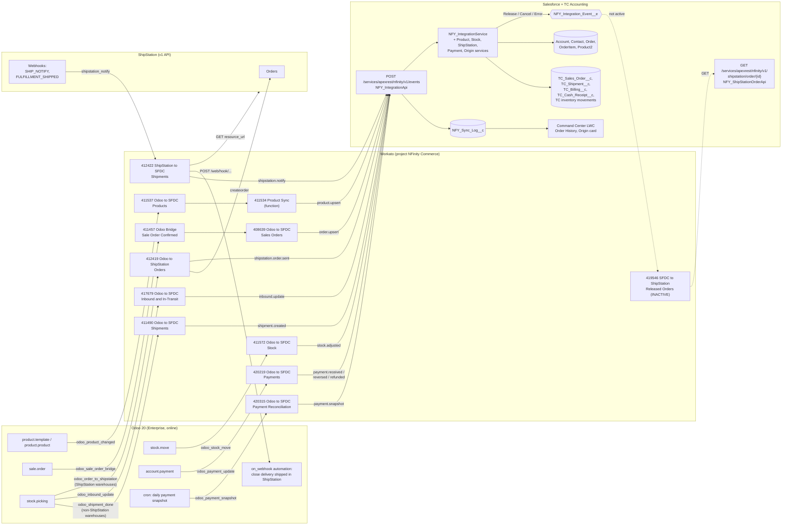
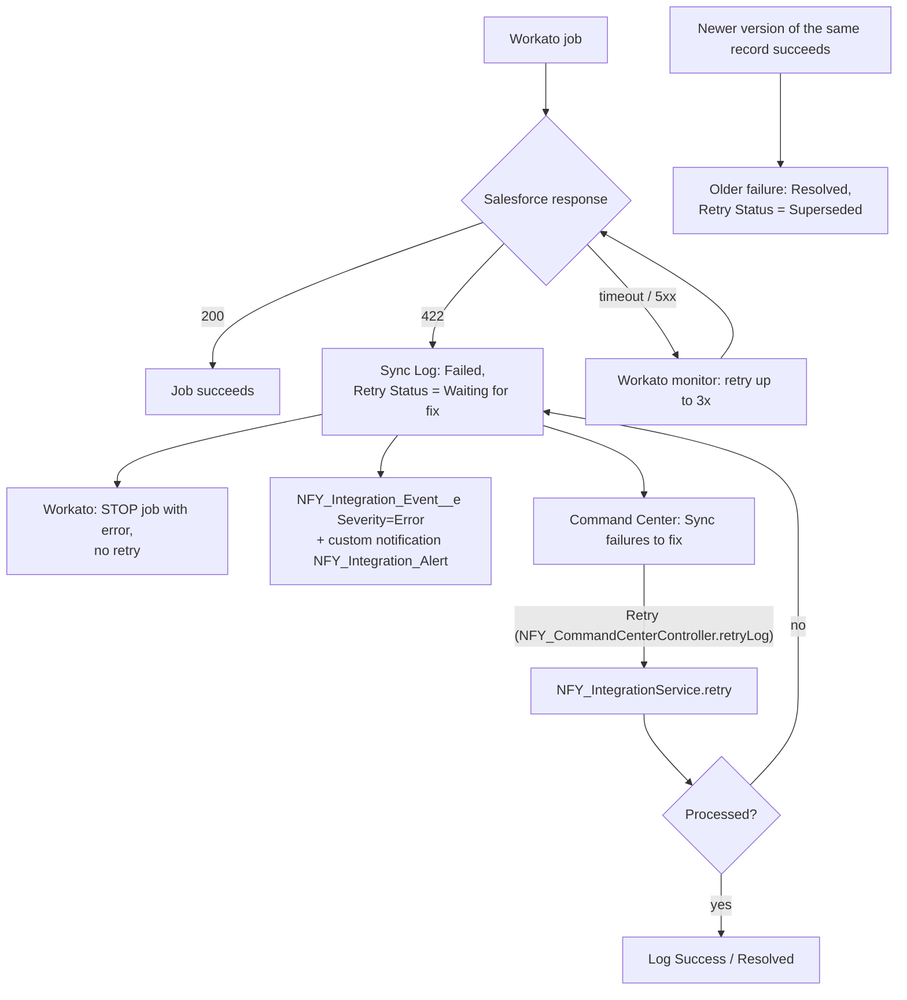

# End-to-end architecture

Odoo is the operational system (products, stock, sales orders, deliveries, payments). Workato carries every event.
Salesforce with TC Accounting is the system of record for orders, inventory value, shipments, billing and cash.
ShipStation prints labels for the warehouses flagged as ShipStation warehouses (today: Nfinity Main, code `MAIN`).

Every event that enters Salesforce goes through one REST endpoint and is written to the Integration Log
(`NFY_Sync_Log__c`) before it is processed.

## System context



## Event contract (Salesforce Integration API)

`POST /services/apexrest/nfinity/v1/events` (class `NFY_IntegrationApi`)

```json
{ "event": "order.upsert", "source": "ODOO_SHOP", "jobId": "<Workato job id>", "payload": { } }
```

| HTTP | Meaning | Workato behaviour |
|---|---|---|
| 200 | Processed, or a repeat of an event already processed (`Duplicate skipped`) | Job succeeds |
| 422 | Processing failed. The event stays in `NFY_Sync_Log__c` as `Failed` and can be retried from Salesforce | Not retried by Workato (the monitor block skips errors that contain `422`); job stops with the Salesforce message |
| 400 | Body is not JSON, or `event` / `source` / `payload` missing | Not retried by the product function (411534); other recipes retry up to 3 times |
| other (timeouts, 5xx, auth) | Transport problem | Monitor block retries all actions up to 3 times, then stops the job with an error |

Events used by this integration (source code in brackets):

| Event | Sent by | Handler |
|---|---|---|
| `order.upsert` (ODOO_SHOP) | 408639 | `NFY_IntegrationService.handleOrder` |
| `product.upsert` (ODOO_SHOP) | 411534, called by 411537 | `NFY_ProductSyncService` |
| `stock.adjusted` (ODOO_SHOP) | 411572 | `NFY_StockSyncService` |
| `shipment.created` (ODOO_SHOP) | 411490 | `NFY_IntegrationService.handleShipment` |
| `inbound.update` (ODOO_SHOP) | 417679 | `NFY_IntegrationService.handleInbound` |
| `payment.received`, `payment.reversed`, `payment.refunded` (ODOO_SHOP) | 420219 | `handlePayment`, `handlePaymentReversed`, `handleRefund` |
| `payment.snapshot` (ODOO_SHOP) | 420315 | `handlePaymentSnapshot` (opens `payment.reconcile` findings) |
| `shipstation.order.sent` (SHIPSTATION) | 412419 | `handleOrderSent` (log only, links to the Order) |
| `shipstation.notify` (SHIPSTATION) | 412422 | `NFY_ShipStationService`, split into one `shipment.created` per shipment |

The API also implements `order.cancelled`, `po.receipt`, `inventory.snapshot`, `return.received` and `settlement.posted`.
No Odoo recipe sends these today (see [implementation inventory](implementation-inventory.md)).

## Keys, idempotency and versioning

| Record | Key format | Notes |
|---|---|---|
| Order | `ODOO-<sale order name>`, e.g. `ODOO-S02009` | `Order.NFY_External_Order_Id__c`; also the ShipStation `orderNumber` |
| Customer | `ODOO-<partner id>` | Account external customer id |
| Product | `ODOO-PRODUCT-<variant id>@<write_date>` | Versioned: a repeat is the same key **and** the same payload |
| Stock move | `ODOO-MOVE-<stock.move id>` | |
| Delivery (ShipStation) | orderKey `ODOO-<picking name with / replaced by ->` | One ShipStation order per Odoo delivery; resends update it |
| ShipStation shipment | `SS-<shipmentId>` or `SS-F-<fulfillmentId>` | |
| Inbound | `ODOO-<transfer name>`; eventId `<inbound>:<STATUS>@<transfer> <write_date>` | Each status and partial receipt is its own event |
| Payment | `ODOO-PAY-<account.payment id>` | `TC_Cash_Receipt__c.NFY_External_Id__c` is unique |

After a versioned event succeeds, older open failures for the same record are closed as `Superseded`.

## Error handling, retry and alerts



- Failed versioned events (products) alert after one minute, and only if the failure is still open.
- Alert recipients: the running user plus active users assigned the `NFY_Demo_User` permission set.
- Duplicates are logged with status `Duplicate skipped` and change nothing.

## Routing rules (where an order ships from)

1. The Odoo user picks **Ship From** on the quotation (`sale.order.x_nfy_ship_from`: `MAIN`, `SM-PA1` or `FBA-US`).
2. Odoo routes the delivery to the location whose `x_nfy_sf_code` matches. If that location cannot cover every line
   and Main can, the delivery falls back to Main and a note is posted on the delivery.
3. Salesforce applies the same rule in `handleOrder`: the requested `TC_Warehouse__c` (`NFY_Code__c`) is kept where stock
   allows, otherwise the line moves to `MAIN`. Units still short are backordered.
4. A delivery goes to ShipStation when its source location (or a parent) has `x_nfy_shipstation = True`.
   Other warehouses report their shipment from Odoo when the delivery is validated.

## Dependencies

| Component | Depends on |
|---|---|
| All Salesforce code | TC Accounting objects and classes in the target org (see [prerequisites](deployment-guide.md#1-prerequisites)) |
| All Workato recipes that post to Salesforce | Workato Salesforce connection with access to `NFY_IntegrationApi` and the NFY objects |
| 412419, 412422 | Workato HTTP connection "ShipStation API" (Basic auth, `https://ssapi.shipstation.com`) |
| 412422 step "Tell Odoo the order shipped" | Workato HTTP connection "Odoo Webhook (no auth)" + the URL of the Odoo on_webhook automation |
| 411457 | Workato HTTP connection "Workato Webhook Forwarder (no auth)" + the webhook URL of 408639 |
| 411537 | Function recipe 411534 must be active |
| Odoo automations | Workato webhook URLs (workspace webhook base + event name) |
| Stock, shipment, inbound payloads | `stock.location.x_nfy_sf_code` set on the top location of each Salesforce warehouse |
| Routing and ShipStation eligibility | `TC_Warehouse__c.NFY_Code__c` equals the Odoo codes; `TC_Warehouse__c.NFY_System__c` names the operator |
