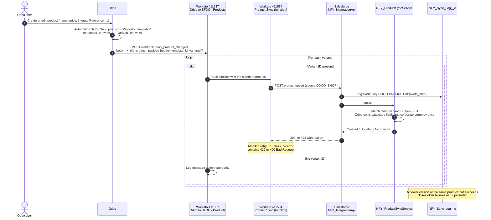

# Flow 1: Product sync (Odoo to Salesforce)

Odoo is the product master. Each sellable variant becomes one `Product2` in Salesforce, matched by the Odoo
variant ID first and the SKU (Odoo Internal Reference, `default_code`) second. Names are never used to match.

## Mapping (Odoo `x_nfy_product_payload` to Salesforce)

| Odoo (variant) | Payload key | Salesforce |
|---|---|---|
| `id` | `id` (sent as `sourceVariantId`) | Odoo product id on Product2 (`NFY_Odoo_Product_Id__c`) |
| `product_tmpl_id` | `template_id` | Source product id |
| `default_code` | `default_code` (sku) | `ProductCode` / SKU |
| name + variant values | `name` | `Name` |
| `description_sale` | `description_sale` | `Description` |
| `categ_id.name` (blank for All / Goods / Saleable) | `categ` | `Family` |
| `active` and template active | `active` | `IsActive` |
| `uom_id.name` (Units becomes Each) | `uom` | `QuantityUnitOfMeasure` |
| `lst_price` | `lst_price` | Standard price book entry (corporate currency) |
| `standard_price` | `standard_price` | Cost |
| `is_storable` | `is_storable` | `TC_Inventory_Product__c` (inventory flag) |
| `write_date` (max of variant and template) | `write_date` | Event version |

The Workato recipe 411537 maps Odoo keys to the standard product payload
(`sku, name, description, family, active, uom, price, currency, cost, storable, sourceProductId, sourceVariantId`)
before calling 411534. The exact field formulas live in the recipe; export it to keep them under version control
(see [Workato README](../../workato/README.md)).

## Business rules

- A product with no SKU fails with "The Odoo product has no SKU" (422). Saving it again with a SKU succeeds and supersedes the failure.
- A SKU already linked to another source product fails with "Mapping conflict" instead of taking it over.
- Odoo can send a half-saved product (no SKU) and then the full one under the same `write_date`; both are kept as separate events because the payloads differ.
