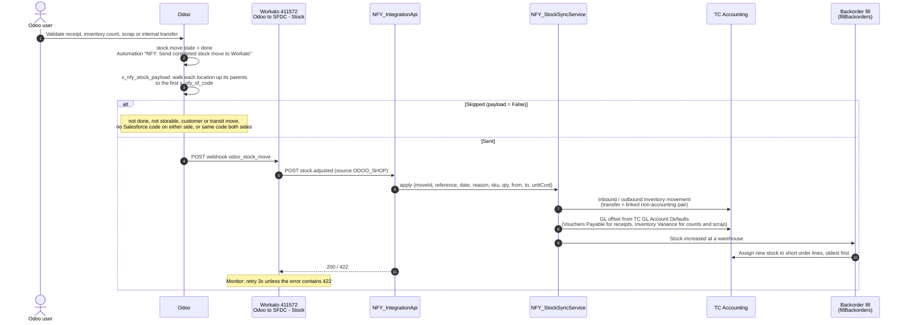

# Flow 2: Stock sync (Odoo to Salesforce, recipe 411572)

Every completed Odoo stock move that changes stock at a Salesforce warehouse is sent as one `stock.adjusted` event.
Salesforce books it as TC inventory movements at the matching `TC_Warehouse__c` / `TC_Location__c`.

## Reason codes

| Odoo move | `reason` |
|---|---|
| From a supplier location | `receipt` |
| From or to a production location | `production` |
| From or to an inventory-loss location named "scrap" | `scrap` |
| From or to another inventory-loss location | `adjustment` |
| Between two internal locations with different codes | `transfer` |

## Warehouse mapping

The only mapping is the Odoo location field `x_nfy_sf_code` = `TC_Warehouse__c.NFY_Code__c`. Child locations inherit
the code of their nearest parent. See [config/warehouse-mapping.csv](../../config/warehouse-mapping.csv).

Customer deliveries are not sent here (they arrive as shipments). Moves into or out of transit are not sent here
(they arrive as inbound updates).
