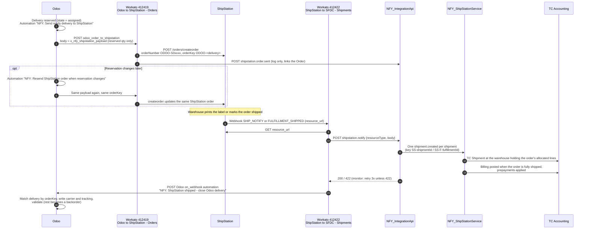

# Flow 4: Shipping (recipes 412419, 412422 and 411490)

Two paths, chosen by the delivery's source location in Odoo:

- **ShipStation warehouse** (`x_nfy_shipstation = True`, today `MAIN`): Odoo sends the ready delivery to ShipStation,
  ShipStation reports the shipment to Salesforce, and Workato then closes the Odoo delivery.
- **Other warehouse** (for example `SM-PA1`): the user validates the delivery in Odoo with carrier and tracking, and
  Odoo reports the shipment.

## Path A: ShipStation warehouse



## Path B: other warehouse (Odoo reports the shipment)

```mermaid
sequenceDiagram
    autonumber
    actor U as Odoo user
    participant O as Odoo
    participant W as Workato 411490<br/>Odoo to SFDC - Shipments
    participant API as NFY_IntegrationApi
    participant TC as TC Accounting

    U->>O: Set Carrier and Tracking Number on the delivery, Validate
    O->>O: Automation "NFY: Send validated delivery to Workato"<br/>(done, outgoing, from a sale, not a ShipStation location)
    O->>W: POST odoo_shipment_done<br/>body = x_nfy_shipment_payload
    W->>API: POST shipment.created (source ODOO_SHOP)
    API->>TC: TC Shipment for the ship-from warehouse;<br/>billing posted when fully shipped
    API-->>W: 200 / 422 (monitor: retry 3x unless 422)
```

## Payload mapping

`x_nfy_shipstation_payload` (ShipStation createorder body)

| ShipStation field | Odoo source |
|---|---|
| `orderNumber` | `ODOO-` + sale order name |
| `orderKey` | `ODOO-` + delivery name (`/` replaced by `-`) |
| `orderDate` | `sale.order.date_order` |
| `orderStatus` | `awaiting_shipment` |
| `billTo`, `shipTo` | delivery partner address |
| `amountPaid` | `sale.order.amount_total` |
| `items[]` | moves with reserved quantity > 0: `lineItemKey` move id, `sku`, `name`, `quantity` (reserved), `unitPrice` |
| `advancedOptions.customField1` | Salesforce warehouse code |
| `advancedOptions.customField2` | Odoo delivery id |
| `advancedOptions.customField3` | `Fully reserved` or `Partly reserved: SKU x of y` |

`x_nfy_shipment_payload` (shipment.created): `shipmentId` (`ODOO-<delivery>`), `orderNumber`, `shipFrom` (code),
`shipDate`, `carrier`, `tracking`, `service` (`Ground`), `labelSystem` (`Odoo`), `lines[] {sku, qty}`.

ShipStation carrier codes mapped back to Odoo `x_nfy_carrier`: ups, ups_walleted to UPS; usps, stamps_com to USPS;
fedex, fedex_walleted to FedEx; dhl_ecommerce; ontrac; amazon_shipping.

## Not active

Recipe **419546 "[SFDC to ShipStation] - Released Orders"** is built but stopped. It listens to
`NFY_Integration_Event__e` (`Release` / `Cancel`) and asks `GET /services/apexrest/nfinity/v1/shipstation/order/{id}?kind=`
(`NFY_ShipStationOrderApi`) whether to send. That endpoint skips orders whose source already reaches ShipStation
through an active "System to system" flow (`SHIPSTATION-ORDER`), so Odoo orders are never sent twice.
Deactivating that flow record would hand ShipStation sending to Salesforce without a code change.

Never validate a ShipStation-warehouse delivery by hand in Odoo: the shipment would be reported twice.
