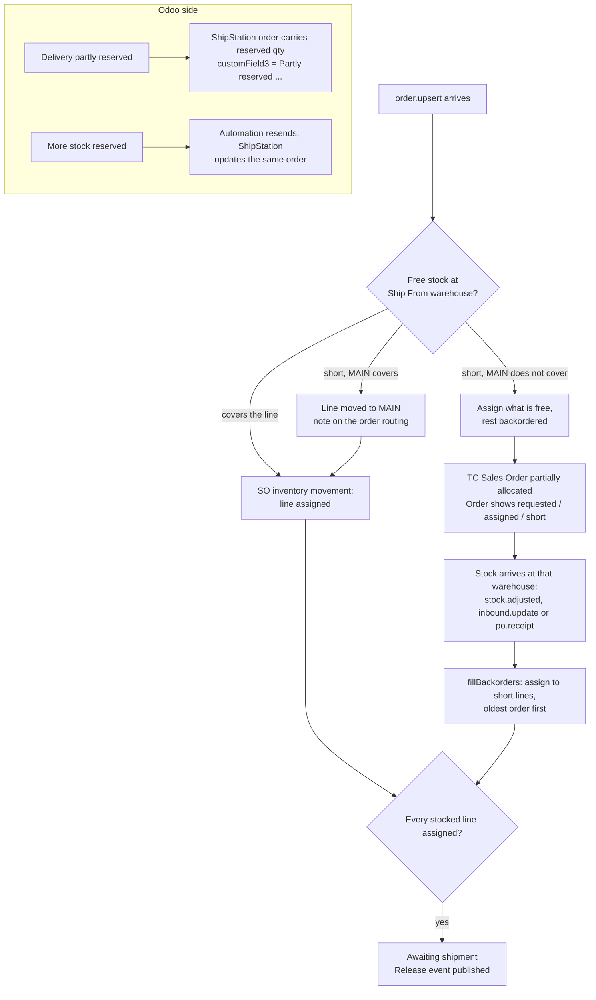

# Flow 5: Warehouse, transfer and backorder processing

Covers what happens when stock is short, when it arrives later, and when stock moves between warehouses through
transit (recipe 417679, event `inbound.update`).

## 5a. Short order, backorder and fill



Committed demand is protected: stock that older open orders are waiting for is not free for a new order.

## 5b. Transfer through transit (inbound and in-transit)

```mermaid
sequenceDiagram
    autonumber
    actor U as Odoo user
    participant O as Odoo
    participant W as Workato 417679<br/>Odoo to SFDC - Inbound and In-Transit
    participant API as NFY_IntegrationApi
    participant S as handleInbound
    participant TC as Salesforce / TC

    U->>O: Internal transfer to "Inter-warehouse transit"<br/>with Final Destination (x_nfy_final_location_id), Validate
    O->>O: Automation "NFY: Inbound shipment leaves for transit"
    O->>O: Server action creates the receipt transit to destination<br/>(x_nfy_inbound_ref = shipping transfer)
    O->>W: inbound payload, status IN_TRANSIT
    W->>API: inbound.update
    API->>S: NFY_Inbound_Shipment__c In Transit,<br/>stock moved to In Transit
    U->>O: Validate the receipt (partial allowed, backorder created)
    O->>W: Automation "NFY: Inbound receipt validated"<br/>status RECEIVING (running totals)
    W->>API: inbound.update (new eventId version)
    API->>S: Received quantities, variance
    U->>O: Validate the backorder
    O->>W: status RECEIVED
    W->>API: inbound.update
    API->>S: Shipment closed; shortfall opens NFY_Inventory_Recon__c
    S->>TC: Received stock fills backorders at the destination
```

Vendor receipts use the same payload: `WORKING` when the receipt is ready, `IN_TRANSIT` once a tracking number is
added (automation "NFY: Vendor receipt tracking added"), `RECEIVED` when validated, `CANCELLED` when cancelled.

Inbound type is set from the destination code: `FBA*` = Amazon FBA inbound, `SM-*` = 3PL ASN, otherwise stock transfer;
supplier receipts are vendor receipts.
